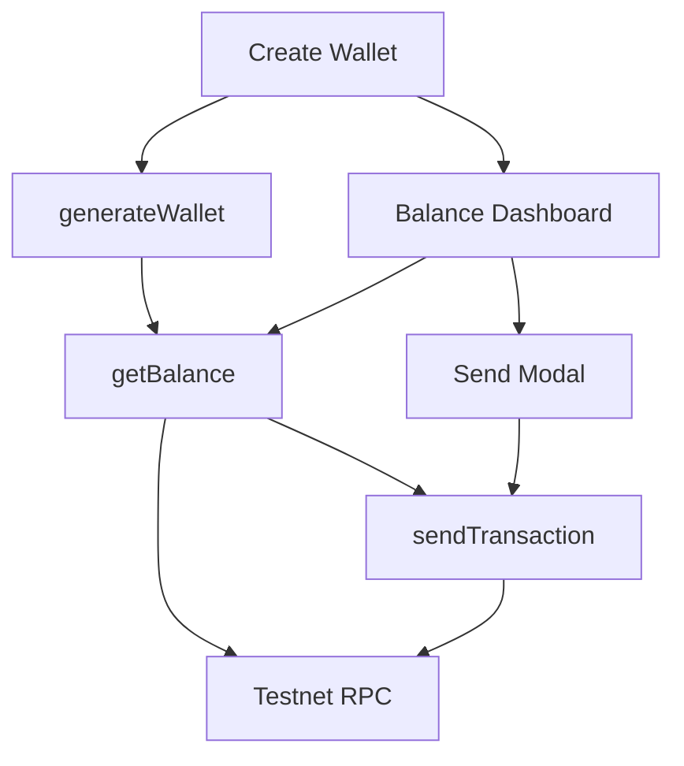

<div align="center">
  
</div>


[](https://github.com/Sweesz/Hexagon-Crypto-Wallet/issues)

# Hexagon
A modern cryptocurrency wallet app built on the TON (The Open Network) blockchain and providing secure and efficient management of digital assets was created by a university team as a course project to demonstrate our skills and teamwork.

## Features

-   **Secure Onboarding:** Client-side mnemonic generation and encrypted local storage.
-   **Real-time Balance:** Instant fetching and conversion of nano-TON to human-readable format.
-   **Safe Transactions:** Mandatory confirmation modals and client-side input validation before signing.
-   **Testnet Integration:** Seamless interaction with TON Testnet RPC nodes and sandbox testing.
-   **Developer Experience:** Strict TypeScript typing, Vitest coverage, and modular Core/UI architecture.

## Prerequisites
Before you begin, ensure you have the following installed:
- **Node.js**: v20.x or higher (LTS recommended)
- **npm**: v9.x or higher
- **Git**: For cloning the repository

> ⚠️ **Important:** This project uses modern crypto APIs. Node.js versions below v18 may experience performance issues with key generation due to entropy limitations.

## Usage and installation

1. ### Clone the repository:
  ```bash
   git clone https://github.com/Sweesz/Hexagon-Crypto-Wallet.git
   cd Hexagon-Crypto-Wallet
```
2. ### Install dependencies:
```bash
npm install
```

3. ### Start the development server:
```bash
npm install
```
4. *Open http://localhost:3000 in your browser.*

## Architecture

Hexagon follows a strict separation of concerns between cryptographic core and UI presentation:




## Tech Stack
| Category        | Technology                             | Purpose                                |
| :-------------- | :------------------------------------- | :------------------------------------- |
| **Language**    | TypeScript                             | Type-safe core and UI logic            |
| **Blockchain**  | TON (The Open Network)                 | Decentralized asset management         |
| **Crypto Core** | `@ton/crypto`, `@ton/core`, `@ton/ton` | Key generation, BOC serialization, RPC |
| **Testing**     | Vitest + @ton/sandbox                  | Unit tests and TVM emulation           |
| **Frontend**    | React + Vite                           | Component-based UI with hot reload     |
| **Security**    | Web Crypto API (AES-GCM)               | Client-side mnemonic encryption        |
## Team Roles & Contributions

### Воронцов Я.Н (Vorontsov Y.N.)
- Technical Director
- System Analyst
- Business Analyst

### Лакомкин А.М (Lakomkin A.M.)
- Designer
- UI/UX Engineer

### Михальский Г.А (Mikhalsky G.A.)
- Frontend Developer
- System Design Contribution
- Backend Development Assistance

### Зязин С.Р (Zyazin S.R.)
- Backend Developer
- Tester
- Testing and test reports


## Acknowledgments

Special thanks to all team members for their dedication and hard work on this project. This student project represents our collaborative effort to build innovative solutions on the TON blockchain.

---

*© 2026 Hexagon Team. This is a student project developed as part of our educational journey.*


