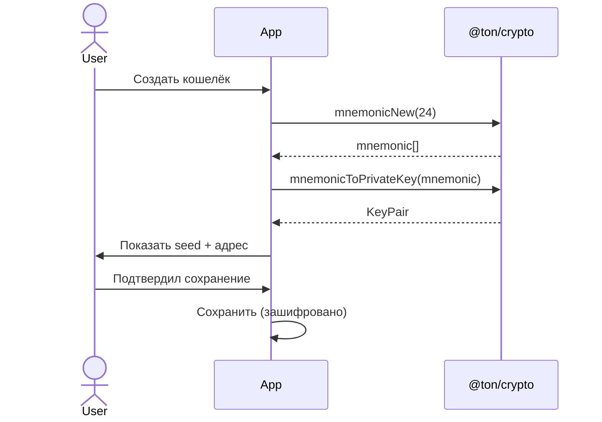
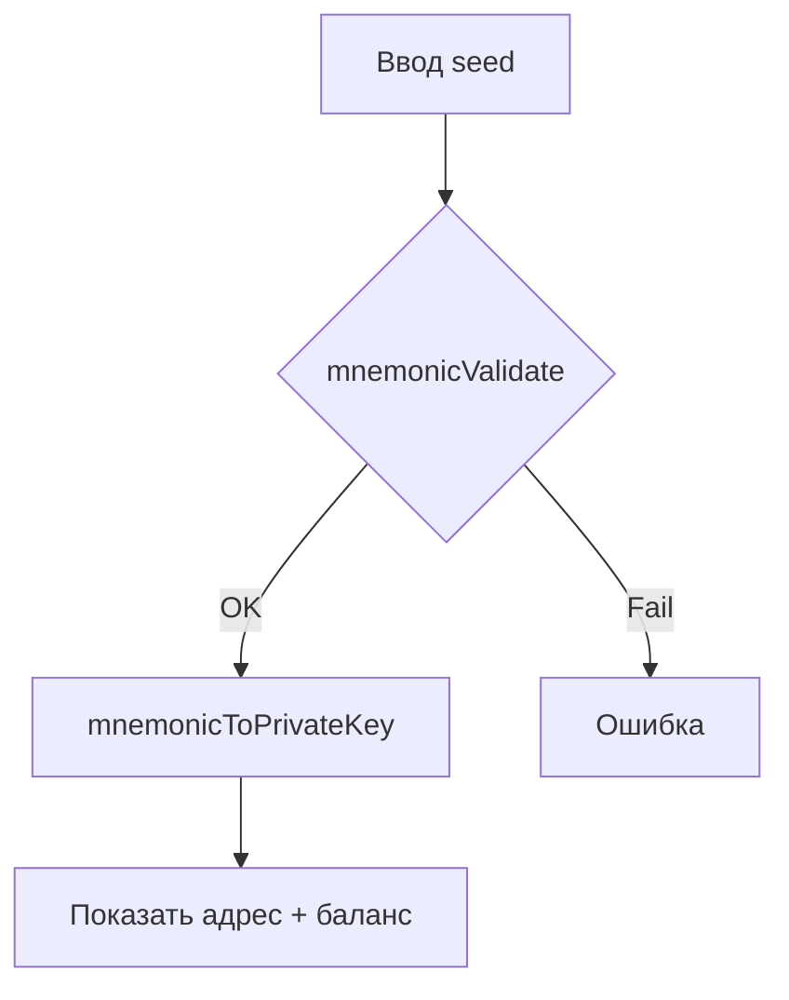
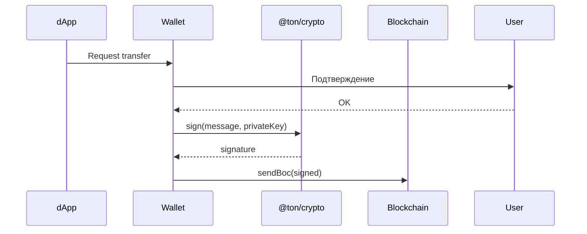
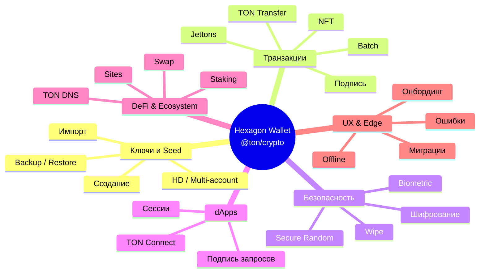

# Use Cases — Hexagon Wallet (powered by `@ton/crypto`)

Библиотека `@ton/crypto` предоставляет криптографические примитивы для безопасной работы с ключами, мнемониками и подписями в TON.  
Ниже — максимально полный список юзкейсов для non-custodial кошелька.

---

## 1. Управление ключами и seed

| ID | Название | Описание | Ключевые методы |
|----|----------|----------|-----------------|
| UC-01 | Создание нового кошелька | Генерация 12/24-словной мнемоники + KeyPair | `mnemonicNew`, `mnemonicToPrivateKey` |
| UC-02 | Создание кошелька с паролем | Мнемоника + optional password | `mnemonicNew(password)` |
| UC-03 | Импорт по seed-фразе | Восстановление из 12/24 слов | `mnemonicValidate` → `mnemonicToPrivateKey` |
| UC-04 | Импорт с паролем | Password-protected mnemonic | `mnemonicValidate(password)` |
| UC-05 | Валидация seed | Проверка корректности перед импортом | `mnemonicValidate` |
| UC-06 | Экспорт seed (показ) | Безопасный показ seed с подтверждением | — |
| UC-07 | Смена seed / пересоздание | Генерация нового кошелька с удалением старого | `mnemonicNew` |
| UC-08 | Backup seed в файл / QR | Экспорт зашифрованного backup | `sealBox` |
| UC-09 | Восстановление из backup | Импорт зашифрованного backup | `openBox` |
| UC-10 | Генерация passphrase | Создание дополнительной фразы | `newSecurePassphrase` |

### Диаграмма: Создание кошелька



### Диаграмма: Импорт кошелька



---

## 2. Иерархические ключи и Multi-Account

| ID | Название | Описание | Ключевые методы |
|----|----------|----------|-----------------|
| UC-11 | Создание master seed | Получение HD seed из мнемоники | `mnemonicToHDSeed` |
| UC-12 | Деривация дочерних ключей | SLIP-10 Ed25519 пути | SLIP-10 HD |
| UC-13 | Создание дополнительного аккаунта | Новый адрес из той же seed | HD derivation |
| UC-14 | Переключение между аккаунтами | Быстрая смена активного кошелька | — |
| UC-15 | Именование аккаунтов | Пользовательские названия (Work, Savings…) | — |
| UC-16 | Удаление аккаунта | Soft-delete с подтверждением | — |
| UC-17 | Экспорт отдельного аккаунта | Экспорт приватного ключа одного аккаунта | — |
| UC-18 | Watch-only аккаунт | Добавление только публичного ключа / адреса | — |

---

## 3. Базовые операции с балансом и адресами

| ID | Название | Описание |
|----|----------|----------|
| UC-19 | Получение адреса | Вычисление friendly/raw/bounceable адреса |
| UC-20 | Копирование адреса | Copy to clipboard + QR |
| UC-21 | Показ QR-кода для получения | QR с адресом + amount |
| UC-22 | Просмотр баланса TON | Актуальный баланс |
| UC-23 | Просмотр истории транзакций | Список входящих/исходящих |
| UC-24 | Детали транзакции | Hash, fee, timestamp, комментарий |
| UC-25 | Поиск по истории | Фильтр по адресу / сумме / дате |
| UC-26 | Экспорт истории | CSV / JSON |

---

## 4. Отправка и получение TON

| ID | Название | Описание | Ключевые методы |
|----|----------|----------|-----------------|
| UC-27 | Отправка TON | Простой transfer | `sign` |
| UC-28 | Отправка с комментарием | Transfer + text comment | `sign` |
| UC-29 | Отправка с memo / payload | Произвольный body | `sign` |
| UC-30 | Отправка с указанием gas | Ручной расчёт комиссии | — |
| UC-31 | Оценка комиссии | Preview fee перед отправкой | — |
| UC-32 | Отмена / замена pending tx | Replace-by-fee (если поддерживается) | — |
| UC-33 | Массовая отправка | Batch transfers | `sign` (несколько) |
| UC-34 | Получение уведомления о входящей | Push / in-app | — |

### Диаграмма: Подпись и отправка транзакции



---

## 5. Jettons (токены)

| ID | Название | Описание |
|----|----------|----------|
| UC-35 | Просмотр списка Jettons | Все токены на адресе |
| UC-36 | Добавление кастомного Jetton | По master-адресу |
| UC-37 | Отправка Jetton | Transfer jetton |
| UC-38 | Получение Jetton | Автоматическое обнаружение |
| UC-39 | Сжигание Jetton | Burn |
| UC-40 | Просмотр Jetton metadata | Название, символ, decimals, лого |
| UC-41 | История Jetton-транзакций | Отдельная лента |

---

## 6. NFT

| ID | Название | Описание |
|----|----------|----------|
| UC-42 | Просмотр NFT-коллекции | Все NFT на адресе |
| UC-43 | Детали NFT | Метаданные, атрибуты, владелец |
| UC-44 | Отправка NFT | Transfer NFT |
| UC-45 | Получение NFT | Автообнаружение |
| UC-46 | Продажа NFT (marketplace) | Подготовка listing |
| UC-47 | Покупка NFT | Подпись покупки |

---

## 7. Подпись и криптография

| ID | Название | Описание | Ключевые методы |
|----|----------|----------|-----------------|
| UC-48 | Подпись транзакции | Основная подпись | `sign` (NaCl) |
| UC-49 | Подпись произвольного сообщения | Для dApps / off-chain | `sign` |
| UC-50 | Проверка подписи | Verify | `verify` |
| UC-51 | Подпись для Wallet V3 | Совместимость | `sign` |
| UC-52 | Подпись для Wallet V4 | Актуальная | `sign` |
| UC-53 | Подпись для Wallet V5 | Новейшая (extensions) | `sign` |
| UC-54 | Multi-signature подготовка | Подготовка multi-sig tx | — |
| UC-55 | Подпись highload-кошелька | Для ботов / массовых операций | — |

---

## 8. Безопасность и шифрование

| ID | Название | Описание | Ключевые методы |
|----|----------|----------|-----------------|
| UC-56 | Локальное шифрование seed | Хранение в encrypted storage | `sealBox` / `openBox` |
| UC-57 | Шифрование с PIN / биометрией | Device key + sealBox | `sealBox` |
| UC-58 | Смена PIN / пароля | Перешифрование | `openBox` → `sealBox` |
| UC-59 | Auto-lock | Блокировка по таймауту | — |
| UC-60 | Biometric unlock | FaceID / TouchID / Fingerprint | — |
| UC-61 | Secure random генерация | Nonce, salt, пароли | `getSecureRandomBytes` |
| UC-62 | Генерация secure words | Дополнительные слова | `newSecureWords` |
| UC-63 | Проверка на утечку seed | Против известных словарей | — |
| UC-64 | Wipe данных | Полное удаление ключей | — |
| UC-65 | Duress PIN | Фейковый PIN с пустым кошельком | — |

---

## 9. TON Connect и dApps

| ID | Название | Описание |
|----|----------|----------|
| UC-66 | Подключение к dApp | TON Connect session |
| UC-67 | Отключение dApp | Disconnect |
| UC-68 | Список подключённых dApps | Управление сессиями |
| UC-69 | Подпись запроса от dApp | Transaction / message |
| UC-70 | Подтверждение подключения | Показ permissions |
| UC-71 | Auto-approve (trusted) | Для доверенных dApps |
| UC-72 | Отклонение запроса | Reject |

---

## 10. Staking и DeFi

| ID | Название | Описание |
|----|----------|----------|
| UC-73 | Просмотр доступных пулов | Список staking pools |
| UC-74 | Стейкинг TON | Delegate |
| UC-75 | Unstake / вывод | Undelegate + claim |
| UC-76 | Просмотр rewards | Начисленные награды |
| UC-77 | Swap (через DEX) | Подпись swap-транзакции |
| UC-78 | Liquidity provide | Добавление ликвидности |
| UC-79 | Claim rewards | Получение наград |

---

## 11. TON DNS, Sites, Proxy

| ID | Название | Описание |
|----|----------|----------|
| UC-80 | Просмотр TON DNS | Привязанные домены |
| UC-81 | Регистрация / продление DNS | Подпись DNS-транзакции |
| UC-82 | Привязка адреса к DNS | Set wallet |
| UC-83 | TON Sites | Открытие .ton сайтов |
| UC-84 | TON Proxy | Подключение через proxy |

---

## 12. Мультисеть и дополнительные функции

| ID | Название | Описание |
|----|----------|----------|
| UC-85 | Переключение Mainnet / Testnet | Смена сети |
| UC-86 | Кастомный RPC / endpoint | Свой lite-server |
| UC-87 | Просмотр raw cell / BOC | Для разработчиков |
| UC-88 | Эмуляция транзакции | Local simulation перед отправкой |
| UC-89 | Gasless transfer (если поддерживается) | Через battery / sponsor |
| UC-90 | Поддержка нескольких workchain | Workchain 0 / -1 |

---

## 13. UX и дополнительные сценарии

| ID | Название | Описание |
|----|----------|----------|
| UC-91 | Онбординг нового пользователя | Пошаговое создание + backup |
| UC-92 | Онбординг существующего | Импорт + проверка |
| UC-93 | Темная / светлая тема | — |
| UC-94 | Мультиязычность | i18n |
| UC-95 | Уведомления о транзакциях | Push |
| UC-96 | Виджеты / quick actions | Быстрая отправка |
| UC-97 | Контакты / адресная книга | Сохранённые адреса |
| UC-98 | Избранные адреса | Quick send |
| UC-99 | Сканер QR | Сканирование адреса / TON Connect |
| UC-100 | Deep links | ```ton://``` / ```tonkeeper://``` обработка |

---

## 14. Edge-cases и ошибки

| ID | Название | Описание |
|----|----------|----------|
| UC-101 | Недостаточно средств | Обработка insufficient balance |
| UC-102 | Невалидный адрес | Валидация перед отправкой |
| UC-103 | Истёкший valid_until | Повторная подпись |
| UC-104 | Offline mode | Просмотр без сети |
| UC-105 | Конфликт seqno | Обработка race condition |
| UC-106 | Повторная отправка failed tx | Retry |
| UC-107 | Восстановление после краша | Safe state recovery |
| UC-108 | Миграция со старых версий кошелька | V1/V2/V3 → V4/V5 |

---

## Диаграмма покрытия



---

## Приоритеты (для планирования)

### Must have (MVP)
- UC-01, UC-03, UC-05  
- UC-19 – UC-22  
- UC-27 – UC-28  
- UC-35 – UC-37  
- UC-48  
- UC-56 – UC-57, UC-61  
- UC-66 – UC-69  
- UC-85  

### Should have
- UC-11 – UC-14  
- UC-42 – UC-44  
- UC-49  
- UC-58 – UC-60  
- UC-73 – UC-75  
- UC-97 – UC-100  

### Could have / Nice to have
- Остальные (DNS, highload, duress PIN, gasless, multi-sig и т.д.)

---

## Рекомендации по безопасности

- Никогда не логировать и не передавать `privateKey` / mnemonic.
- Хранить seed только в зашифрованном виде (`sealBox` + device keystore / biometric).
- Использовать `getSecureRandom*` вместо обычного `Math.random`.
- Валидировать все входящие мнемоники через `mnemonicValidate`.
- Поддерживать актуальные версии кошельков: **Wallet V4** и **Wallet V5**.
- Все подписи выполнять только локально.

---
